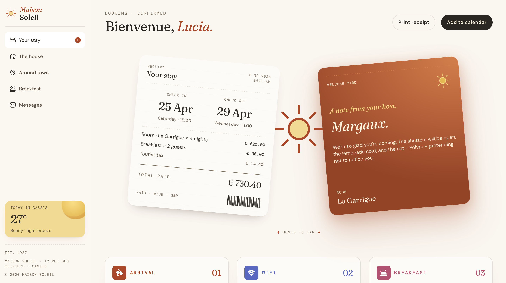

# || Hotel booking confirmation page solution ||

This is a solution to the [Hotel booking confirmation page challenge on Frontend Mentor](https://www.frontendmentor.io/challenges/hotel-booking-confirmation-page).

**Maison Soleil** is a booking confirmation for a stay at Maison Soleil in Cassis. One responsive page covers the desktop, tablet, and mobile design frames, including the open navigation drawer, the card fan, and keyboard focus.

## Table of contents

- [Overview](#overview)
  - [The challenge](#the-challenge)
  - [Screenshot](#screenshot)
  - [Links](#links)
- [Getting started](#getting-started)
  - [Prerequisites](#prerequisites)
  - [Setup](#setup)
  - [Scripts](#scripts)
- [Folder structure](#folder-structure)
- [Breakpoints](#breakpoints)
- [Interactions](#interactions)
- [Accessibility](#accessibility)
- [My process](#my-process)
  - [Built with](#built-with)
  - [What I learned](#what-i-learned)
  - [Continued development](#continued-development)
  - [Useful resources](#useful-resources)
  - [AI Collaboration](#ai-collaboration)
- [Author](#author)
- [Acknowledgments](#acknowledgments)

## Overview

### The challenge

Users should be able to:

- View the optimal layout for the interface depending on their device's screen size
- See hover and focus states for all interactive elements on the page
- Open and close the navigation menu on smaller screens (optional JavaScript)
- Copy the Wi-Fi password to their clipboard using the copy button (optional JavaScript)

### Extras built on top of the brief:

- Fan the receipt and welcome card on hover (or tap on touch devices) to reveal the sun illustration
- Print a receipt-only version of the page
- Download the stay as an `.ics` calendar event

### Screenshot



### Links

- Solution URL: [Add solution URL here](https://your-solution-url.com)
- Live Site URL: [Add live site URL here](https://your-live-site-url.com)

## Getting started

### Prerequisites

- npm (ships with Node.js)
- [Node.js](https://nodejs.org/) 20.19+ or 22.12+ (required by Vite 7)

### Setup

```bash
npm install
npm run dev
```

The dev server prints a local URL. Production output goes to `dist/`.

### Scripts

| Command                | What it does                                                |
| ---------------------- | ----------------------------------------------------------- |
| `npm run dev`          | Starts the Vite dev server with hot reload                  |
| `npm run build`        | Type-checks, then builds the production bundle into `dist/` |
| `npm run preview`      | Serves the production build locally                         |
| `npm run lint`         | Runs ESLint                                                 |
| `npm run typecheck`    | Runs the TypeScript compiler without emitting files         |
| `npm run format`       | Formats the project with Prettier                           |
| `npm run format:check` | Checks formatting without writing changes                   |
| `npm run package`      | Builds, then writes `maison-soleil-project.zip` (see below) |

`npm run package` runs the production build, then writes `maison-soleil-project.zip` in the project root. The archive contains the source, README, `package.json`, and the lockfile. It leaves out `node_modules` and `dist`.

## Folder structure

```text
src/
  assets/            icons, illustration, barcode, logo, self-hosted fonts
  components/ui/     Button, Card, Badge, Icon
  components/layout/ PageShell, Sidebar, AppBar, Header
  features/          BookingCards, ReceiptCard, WelcomeNote, WeatherWidget, InfoCards
  hooks/             useMediaQuery
  lib/calendar.ts    .ics builder and download for "Add to calendar"
  data/stay.ts       guest, receipt, welcome note, weather, navigation
  styles/index.css   tokens and global styles
  App.tsx            page composition
  main.tsx           React entry point
public/
  favicon-32x32.png
index.html           meta tags, font preloads, root element
```

## Breakpoints

The layout is mobile-first and fluid between the artboards.

| Range         | Layout                                                                                           |
| ------------- | ------------------------------------------------------------------------------------------------ |
| under 768px   | Mobile. Stacked welcome note and receipt, one-column info cards, slide-in drawer (320px).        |
| 768px–1023px  | Tablet. Side-by-side booking cards, info cards wrap from a 17.5rem minimum, drawer is 384px.     |
| 1024px and up | Desktop. Fixed 260px sidebar. Info cards become three columns once each can be at least 17.5rem. |

Page padding uses `clamp` so it lands near 16px, 24px, and 40px at the mobile, tablet, and desktop artboards. The content column caps at 90rem on very wide screens. The sidebar stays fixed.

## Interactions

- Hover or the “hover to fan” control fans the receipt and welcome card and reveals the sun. Touch devices that show the pair can tap the cards or the control. `prefers-reduced-motion` removes the motion.
- Focus rings use the Figma terracotta ring. The drawer traps focus, closes on Escape, locks scroll, and sets `aria-expanded` on the menu button.
- Print receipt opens the browser print dialog with a receipt-only stylesheet.
- Add to calendar downloads `maison-soleil-stay.ics`.
- Copy places the Wi-Fi password on the clipboard.

## Accessibility

- Semantic landmarks and a single `<h1>` per page
- Every interactive element is reachable by keyboard and shows the terracotta focus ring
- The navigation drawer traps focus, closes on Escape, and exposes its state through `aria-expanded`
- The Wi-Fi copy button announces “Password copied to clipboard.” through a live region
- Animations respect `prefers-reduced-motion`
- Safe-area insets (`env(safe-area-inset-*)`) keep content clear of notches on mobile devices

## My process

### Built with

- [React 18](https://react.dev/) - JS library
- [TypeScript](https://www.typescriptlang.org/) - Type safety
- [Vite](https://vite.dev/) - Build tool and dev server
- [Tailwind CSS v4](https://tailwindcss.com/) - Utility-first styling
- [Framer Motion](https://motion.dev/) - Card fan animation
- [ESLint](https://eslint.org/) and [Prettier](https://prettier.io/) - Linting and formatting

### What I learned

**Defining design variables once as Tailwind v4 theme tokens.** Declaring the palette, spacing, and radii under `@theme` in `src/styles/index.css` keeps every component in sync with the design file.

**Fluid spacing with `clamp()`.** Instead of jumping between fixed values at each breakpoint, the page padding scales smoothly between the artboards:

```css
.main-inner {
  padding: clamp(1.25rem, 0.4rem + 2vw, 2rem) clamp(1rem, 0.35rem + 2.4vw, 2.5rem)
    clamp(2rem, 1rem + 3vw, 3rem);
}
```

**Subscribing to media queries the React 18 way.** `useSyncExternalStore` keeps a component in sync with `matchMedia` without effects or stale state:

```ts
export function useMediaQuery(query: string): boolean {
  return useSyncExternalStore(
    (onChange) => subscribe(query, onChange),
    () => window.matchMedia(query).matches,
    () => false,
  )
}
```

**Using the Clipboard API with feedback.** The copy button writes the Wi-Fi password and shows a short-lived confirmation:

```ts
const copyPassword = async () => {
  try {
    await navigator.clipboard.writeText(wifi.password)
    setCopied(true)
    window.setTimeout(() => setCopied(false), 2000)
  } catch {
    setCopied(false)
  }
}
```

**Generating an `.ics` file in the browser.** `src/lib/calendar.ts` builds a calendar event as text, wraps it in a `Blob`, and triggers a download, with no backend needed.

### Continued development

- Add automated tests (unit tests for `calendar.ts`, component tests for the drawer and copy button)
- Run automated accessibility audits (axe, Lighthouse) as part of the build
- Explore a dark theme built from the same token set
- Load booking data from an API instead of the static `data/stay.ts`

### Useful resources

- [Tailwind CSS v4 – Theme variables](https://tailwindcss.com/docs/theme) - How `@theme` turns design tokens into utilities.
- [MDN – CSS `clamp()`](https://developer.mozilla.org/en-US/docs/Web/CSS/clamp) - The basis for the fluid page padding and type.
- [MDN – Clipboard API](https://developer.mozilla.org/en-US/docs/Web/API/Clipboard_API) - Used for the Wi-Fi copy button.
- [React – `useSyncExternalStore`](https://react.dev/reference/react/useSyncExternalStore) - Used for the `useMediaQuery` hook.
- [WAI-ARIA Authoring Practices – Dialog (Modal)](https://www.w3.org/WAI/ARIA/apg/patterns/dialog-modal/) - Guidance for the focus-trapped navigation drawer.
- [Framer Motion docs](https://motion.dev/docs/react) - Animation and `useReducedMotion`.

### AI Collaboration

- **Tools:** Claude Code AI
- **How I used it:** Reviewing structure, writing short notes-pick points and organizing documentation plus checking the implementation against the design frames.
- **What worked well:** Quick feedback on accessibility details and consistent documentation.
- **What didn't:** Suggestions still had to be checked against the design and tested in the browser.

## Author

- Website - [Joke wizzo](https://www.wizzoviz.tech/)
- Twitter - [Stillwizzo](https://x.com/stillwizzo)
- LinkedIn - [Kuach John](https://www.linkedin.com/in/kuach-john-565ab62aa/)
- Frontend Mentor - [Kuach-joke](https://www.frontendmentor.io/profile/Kuach-joke)

## Acknowledgments

- [Frontend Mentor](https://www.frontendmentor.io/) for the challenge and for the provision of its design files
- Fonts: [Fraunces](https://fonts.google.com/specimen/Fraunces), [DM Sans](https://fonts.google.com/specimen/DM+Sans), and [DM Mono](https://fonts.google.com/specimen/DM+Mono), self-hosted under the SIL Open Font License (licence files in `src/assets/fonts/`)
